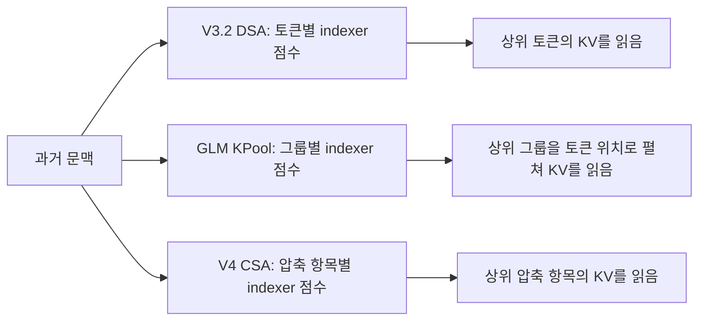

# 긴 문맥을 읽는 방식: DSA, Lightning Indexer, KPool

## 수업 개요

긴 계약서 마지막에 “앞에서 정한 갱신 조건이 뭐였지?”라는 질문이 붙었다고 하자. 최근 토큰만 보는 창은 읽을 범위를 쉽게 정하지만, 조건이 문서 앞부분에 있으면 그 위치를 현재 층에서 직접 참조할 수 없다. DeepSeek Sparse Attention(DSA)은 쿼리마다 과거 후보를 점수화해 읽을 위치를 고른다. GLM-5.3-Flash의 KPool은 점수를 매길 후보를 토큰 그룹으로 묶고, DeepSeek-V4의 CSA는 본 어텐션이 읽을 KV 항목까지 압축한다. [S1][S2][S3][S4][S5]

## 학습 목표

- causal sliding window와 쿼리별 sparse selection의 참조 범위를 비교한다.
- Lightning Indexer의 점수와 본 어텐션의 가중치를 구분하고, 양쪽의 계산량을 따로 계산한다.
- GLM KPool, DeepSeek CSA/HCA, CSA2에서 어떤 단위로 점수를 매기고 어떤 KV를 읽는지 설명한다.

## 같은 문맥, 세 가지 선택 단위

**학습자:** 마지막 토큰이 오래된 조항을 참조해야 한다면, sliding window를 무조건 넓혀야 하나요?

**교수자:** 고정된 local window에서는 현재 층이 직접 참조할 수 있는 위치가 거리로 정해집니다. Longformer는 local window에 일부 위치의 global attention을 결합하는 사례입니다. DSA는 쿼리 내용에 따라 참조 위치를 바꾸는 접근입니다. [S1][S2]

예를 들어 causal window가 현재 위치를 포함해 4토큰이면 8번째 쿼리는 5~8번을 본다. 4토큰 블록을 연산 단위로 쓰면 1~4번 블록 전체를 건너뛸 수 있다. 7번째 쿼리는 4~7번을 보므로 두 블록에 걸치고, 블록 내부의 1~3번과 8번은 가린다. 토큰별 참조 규칙을 블록에 옮길 때 이 경계 처리가 필요하다.

**교수자:** DeepSeek-V3.2의 Lightning Indexer는 과거 위치마다 별도의 indexer key를 사용합니다. 쿼리 쪽의 여러 indexer head가 낸 점수를 가중합하고, causal 범위 안에서 상위 위치를 고릅니다. 본 어텐션은 그 위치의 MLA KV 항목을 읽어 자기 가중치로 출력을 계산합니다. 아래 식에서 $I_{t,s}$는 후보의 순위를 매기는 점수입니다. [S2]

$$
I_{t,s} = \sum_{j=1}^{H^I} w^I_{t,j}\,\mathrm{ReLU}\bigl(q^I_{t,j}\cdot k^I_s\bigr)
$$

**학습자:** 본 어텐션이 상위 $k$개만 보면 prefill 전체도 문맥 길이에 선형인가요?

**교수자:** 길이가 $L$인 causal prefill에서 모든 과거 후보를 점수화하는 V3.2 indexer는 $O(L^2)$이고, 본 어텐션이 읽는 쿼리–KV 쌍은 최대 $O(Lk)$입니다. 쿼리 하나를 처리하는 decode에서는 각각 최대 $O(L)$과 $O(k)$입니다. head와 차원을 고정한 비교입니다. 실제 시간에는 top-k 선택, KV 접근, 구현 방식도 들어갑니다. [S2]

### KPool은 무엇을 묶는가

**학습자:** KPool이 네 토큰을 하나로 묶으면 본 어텐션도 그 대표 벡터 하나만 보나요?

**교수자:** GLM-5.3-Flash에서 묶는 것은 **선택용 indexer key**입니다. 공개 설정은 `index_kpool=4`, `index_topk=2048`입니다. Transformers 구현은 최대 512개 완료 그룹을 선택해 토큰 위치로 펼칩니다. 설정에 따라 아직 그룹이 완성되지 않은, 현재 쿼리가 볼 수 있는 꼬리 토큰도 별도로 포함합니다. 이 경로에서는 그룹 안의 토큰마다 본 어텐션에 들어갈 자격을 다시 순위화하지 않습니다. [S3][S4]

### CSA는 본 어텐션의 입력도 바꾼다

**교수자:** DeepSeek-V4의 CSA에서는 indexer가 압축 항목을 고르고, 본 어텐션이 **압축된 main KV 항목 자체**를 읽습니다. HCA는 더 강하게 압축한 항목 전체를 참조하며 해당 경로에 top-k indexer가 없습니다. 두 방식은 최근 문맥을 위한 sliding-window 경로를 함께 둡니다. [S5]

### 16개 토큰으로 손계산하기

아래는 local window와 꼬리 처리를 빼고 전역 선택 경로만 비교하는 학습용 예다. 본 어텐션의 읽기 예산을 4개 **항목**으로 맞추고, CSA는 설명을 위해 압축 항목 1개가 원문 4토큰을 요약한다고 단순화한다. 실제 V4 CSA의 압축 구간에는 겹침이 있으며, 토큰 KV 4개와 압축 KV 4개가 보존하는 정보도 다르다. [S2][S4][S5]

| 방식 | 쿼리 하나가 점수화할 후보 | 본 어텐션의 전역 입력 |
| --- | --- | --- |
| DSA | 토큰 위치 16개 | 고른 토큰의 KV 4개 |
| KPool, 그룹 크기 4 | 그룹 4개 | 고른 그룹 1개를 펼친 토큰 KV 4개 |
| CSA, 예시 압축 비율 4 | 압축 항목 4개 | 예산 안의 압축 KV 4개 |

핵심 단어 하나가 다른 그룹에 흩어져 있으면 DSA는 각각의 토큰을 독립적으로 고를 수 있다. KPool 사례에서는 한 그룹의 순위가 높아지면 그 안의 토큰들이 함께 선택된다. CSA의 과거 정보는 요약 벡터를 통해 전달된다. 어느 방식이 필요한 근거를 더 잘 보존하는지는 문맥과 모델에 따라 직접 평가해야 한다.

## 심화 읽기: CSA2와 계층형 indexer

DeepSeek-V4.1-Flash의 CSA2에서는 층 간 main KV 공유와 top-k 인덱스 재사용을 별도로 구성한다. 디코더의 계층형 indexer는 앞선 indexer가 만든 후보 집합을 활용해 이후 indexer가 점수화할 범위를 제한한다. KPool과 나란히 읽을 때는 **후보 한 개의 단위를 바꿨는지**, **다음 탐색의 후보 집합을 좁혔는지**, **이미 고른 인덱스를 재사용했는지**를 표시해 보자. [S6]

이어 읽기: [Long-Context Serving and KV Memory](../../../02-serving-systems/02-cache-batching-and-generation/06-long-context-serving-and-kv-memory/README.md)에서 indexer, top-k, KV 조회, 본 어텐션을 따로 측정한다.

[어텐션 헤드와 KV 표현](../03-attention-heads-and-kv-representations/README.md)은 MLA가 저장하는 값을, [Linear Attention과 Hybrid 모델](../04-linear-and-hybrid-attention/README.md)은 과거를 상태에 누적하는 방식을 설명한다.

## 출처

| ID | 출처 | 발행처 | 날짜 | URL | 이 챕터에서 사용한 역할 |
| --- | --- | --- | --- | --- | --- |
| [S1] | Longformer §3 | Beltagy et al. | 2020 | https://arxiv.org/abs/2004.05150 | local window와 global attention 패턴 |
| [S2] | DeepSeek-V3.2 §2.1, §2.3 | DeepSeek-AI | 2025 | https://arxiv.org/html/2512.02556 | DSA의 점수식, MLA 연동, indexer와 core attention의 비용 |
| [S3] | GLM-5.3-Flash config.json | Z.ai | 2026-11-20 확인 | https://huggingface.co/zai-org/GLM-5.3-Flash/blob/main/config.json | 공개 체크포인트의 그룹 크기, 선택 예산과 tail 설정 |
| [S4] | GLM-5.3-Flash indexer 구현 | Hugging Face Transformers | 2026-11-20 확인 | https://github.com/huggingface/transformers/blob/main/src/transformers/models/glm5_next/modeling_glm5_next.py | 그룹 선택 예산, causal 범위, 토큰 위치 복원과 tail 처리 |
| [S5] | DeepSeek-V4 §2.3 | DeepSeek-AI | 2026 | https://arxiv.org/html/2606.19348 | CSA와 HCA의 main KV 압축 및 local window |
| [S6] | DeepSeek-V4.1-Flash §2.3 | DeepSeek-AI | 2026 | https://arxiv.org/html/2609.19969 | 층 간 KV 및 top-k 재사용과 계층형 indexer |
